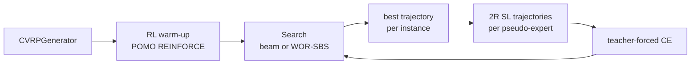

# Self-improvement learning with stochastic beam search

How POMO is trained by self-improvement learning (SIL) on CVRP, how the Gumbeldore search was
ported, and where it deliberately differs from the reference. Written for anyone running or
changing `notebooks/POMO_sil.py`, `src/sil/`, `src/envs/cvrp_sil.py` and
`src/models/pomo_sil.py`.

The reference is `/home/toothlessos/Projects/nrp/gumbeldore` (TMLR paper *Self-Improvement for
Neural Combinatorial Optimization: Sample Without Replacement, but Improvement*). The parts
ported here are `core/stochastic_beam_search.py`, the WOR path of `core/incremental_sbs.py`,
and the generate-then-teach loop of `cvrp_main.py`.

## Why this exists

The repository trains CVRP100 three ways: POMO REINFORCE on generated instances (`rl-`),
teacher forcing on HGS tours (`sl-`), and LEHD-style partial reconstruction (`lehd-`). SIL adds
a fourth: the policy generates its own solutions, the search keeps the best one per instance,
and the policy is trained by teacher forcing on those pseudo-experts. No reference solution is
ever read.

The reference pipeline has no warm-up. This experiment adds one because the policy has to be
good enough for its own samples to be useful: the first `WARMUP_EPOCHS` epochs are POMO
REINFORCE on the same `CVRPGenerator` distribution as `notebooks/POMO_og.py`, then the objective
switches to SIL. The generator is unchanged, so SIL and the warm-up see the same instance
distribution; only the labels change, from returns to self-generated trajectories.

Two sample generators are compared under the same budget:

1. **Plain beam search** -- deterministic SBS, one round, `BEAM_WIDTH * NUM_ROUNDS` wide.
2. **WOR-SBS** -- stochastic SBS with residual-mass subtraction, `BEAM_WIDTH` wide for
   `NUM_ROUNDS` rounds.

Both arms use the same search tree, adapter, candidate budget and training recipe, so the
comparison isolates how the trajectories are sampled.



## The search state and adapter

`src/sil/trajectory.py` translates an rl4co CVRP state into the abstract state the Gumbeldore
search expects. A `SILState` is one partial solution:

| field | meaning |
| --- | --- |
| `instance` | row of the generation chunk |
| `visited` | `[N+1]` uint8, index 0 is the depot slot |
| `current` | current node, 0 at the depot |
| `used` | normalised load of the current vehicle |
| `mask` | `[N+1]` bool, `True` = feasible (rl4co's convention) |
| `done` | whether the episode has terminated |
| `actions` | actions from the root through this state |
| `cost` | cumulative Euclidean length |

Two properties make the adapter cheap. First, the encoder depends only on the instance and the
decoder is stateless with respect to decode progress, so one `PrecomputedCache` per chunk serves
every node of every tree -- the same property `src/mcts/oracle.py` relies on. Second, rl4co's
CVRP action space is a fixed `[N+1]` axis at every depth (`0` = depot), unlike Gumbeldore's
`2N` `(customer, via_depot)` space, so states at different depths share one action ordering and
no re-indexing is needed.

States live on the CPU as NumPy arrays. `SILSearchAdapter.child_log_probability_fn` builds one
minimal decoder TensorDict (`current_node`, `used_capacity`, `vehicle_capacity`,
`action_mask`), index-selects the cache rows for the batch, and calls
`policy.decoder(td, cached, num_starts=1)` followed by rl4co's `process_logits`, so SIL samples
from exactly the distribution POMO decodes with. `child_transition_fn` steps the environment once
for the whole level, then bulk-extracts the child fields with one `.cpu().numpy()` per field --
per-row `.item()` would synchronise thousands of times per level.

### Cost, and the implicit return edge

rl4co terminates an episode when every node including the depot slot has been visited. The depot
slot is set on the first route return, so in a multi-route episode `done` fires on the last
**customer**, not on a final depot action; `env.get_reward` closes the tour implicitly. The
adapter therefore adds `d(last_customer, depot)` to a terminal child's cost. Without it the leaf
cost is short by one edge; `scripts/verify_sil.py` checks the result against
`env.get_reward` to `1e-4` and it matches to float32 precision.

## The two samplers

### Stochastic beam search (`src/sil/sbs.py`)

A port of `core/stochastic_beam_search.py`, unchanged in behaviour. Each internal node gets a
Gumbel sampled conditionally on its parent's Gumbel (equations 23/24 of the SBS paper):

```
g ~ Gumbel(phi + log p(child | parent)), then shifted so max(g) = g_parent
```

The beam keeps the top `k` Gumbels over new children and existing leaves. Because the returned
Gumbel is the top-down Gumbel process of the tree, the top-`k` leaves are an ordered sample
**without replacement** from `p(trajectory) ∝ exp(cumulative log-probability)`. Leaves may sit at
different depths, which CVRP needs because route boundaries add actions.

`deterministic=True` sets Gumbel = cumulative log-probability instead of sampling, which reduces
the algorithm to ordinary beam search. That is the plain-beam arm: same tree, same pruning, same
adapter, no stochasticity.

### WOR-SBS (`src/sil/incremental_sbs.py`)

`IncrementalSBS` keeps a persistent trie across rounds. Every node stores the **residual
absolute log mass** of each child edge, not the raw policy probability:

```
u(y) = log p(y | x) + m_parent
```

After a leaf is sampled, its mass is removed from every edge on its path:

```
m_edge <- log(exp(m_edge) - exp(m_leaf))
```

so a sampled full sequence has zero residual mass and can never be sampled again. Repeating SBS
rounds against the same trie therefore samples without replacement. When a trie node is revisited,
its cached masses (plus any accumulated advantage) are renormalised and used instead of querying
the policy again. `perform_incremental_sbs` concatenates every round's leaves, and the generator
keeps the cheapest leaf per instance.

The trie's policy-update machinery is ported in full -- `children_advantages`,
`children_visit_counts`, `add_simple_advantage`, `obtain_locally_estimated_advantage`,
`compute_expected_outcome`, `gumbel_without_replacement_expectation` and the
`"gumbeldore"`/`"theory_gumbeldore"` branches -- but it is **dormant**. `SILSearchConfig`
validates `log_prob_update_type == "wor"` and `generate_best_solutions` rejects anything else, so
stage 1 cannot switch the update on by accident. `scripts/verify_sil.py` still runs both dormant
updates once, so the code cannot rot before the next stage.

### The comparison is budget-matched

| arm | width | rounds | candidate trajectories per instance |
| --- | --- | --- | --- |
| `wor` | 32 | 4 | 128 |
| `beam_search` | 128 | 1 | 128 |

The beam arm's width is derived in the script (`BEAM_WIDTH * NUM_ROUNDS`), not set independently,
so an edit to one arm's budget is reflected in the other.

## Generation and the pseudo-expert dataset

`src/sil/search.py:generate_best_solutions` generates `NUM_INSTANCES_TO_GENERATE` fresh
instances with `env.generator` (the same `CVRPGenerator(num_loc=100, capacity=50)` the RL runs
use), splits them into `SEARCH_CHUNK_SIZE` chunks, encodes each chunk once, and runs the chosen
sampler. Chunk size bounds the decoder batch: from round two onward, up to
`chunk_size * beam_width` rows are materialised by the cache `index_select`, roughly 200 KB per
row at `N=100`, `dim=128`. Keep it at 16-32.

Each instance contributes exactly one record: its cheapest complete trajectory, converted back
to the tagged-file representation with `src/lehd/subpath.actions_to_routes` and
`flatten_routes`. The record stores:

* `depot`, `locs` (`[N,2]`, depot excluded);
* `demand` **already normalised by the vehicle capacity** and `capacity = 1.0`;
* `tour`/`flags` and the number of routes;
* `cost`, recomputed from the coordinates with `cost_from_flags`.

The normalisation is load-bearing. `InstanceInputMixin.make_input_td` divides `demand` by
`capacity`; storing generator-normalised demand with `capacity=50` would divide a second time and
silently disable the capacity mask.

Reproducibility is explicit: the generator runs under `torch.random.fork_rng` with
`manual_seed(seed + epoch)`, and each chunk's Gumbels come from
`np.random.default_rng([seed, chunk_start])`. Chunking changes the RNG stream, so the chunk size
is part of the reproduction recipe.

## The SIL training dataset

`src/sil/dataset.py:SILSolutionDataset` reuses the SL data contract end to end. Each record has
`R` routes, and each route can be served first from either end, so every record expands to `2R`
legal trajectories -- exactly the construction of `CVRPSolutionDataset.build_trajectory`. The
dataset returns the same item dict (`depot`, `locs`, `demand`, `capacity`, `cost`, `actions`,
`start_node`, `num_routes`) and reuses `CVRPSolutionDataset.collate_fn` unchanged, so `POMOSL`'s
teacher-forced loss applies without modification.

The epoch length is **explicit**: `SIL_BATCHES_PER_EPOCH * SIL_BATCH_SIZE` slots are drawn in
`__init__` (without replacement when the epoch is shorter than the pool, with replacement
otherwise). Appending records on a non-improving epoch therefore cannot silently change the
number of optimizer steps. The DataLoader uses zero workers; under spawn each worker would pickle
the whole record pool, and the per-item work is trivial.

## Training: one run, two phases

`src/models/pomo_sil.py:POMOSIL(POMORL)` switches on `current_epoch`, which Lightning sets before
`train_dataloader()` is called at the start of each epoch.

**Warm-up** (`epoch < warmup_epochs`): `POMO.shared_step` and `super().train_dataloader()`, i.e.
the `POMO_og.py` loop unchanged -- REINFORCE with the shared baseline over `N` starts, 100,000
generated instances per epoch. The base class refreshes that generator dataset at the end of each
epoch.

**SIL** (`epoch >= warmup_epochs`):

* `train_dataloader()` calls `_ensure_generated()`, builds `SILSolutionDataset` from the installed
  records, and returns a DataLoader over `SIL_BATCHES_PER_EPOCH` steps.
* `shared_step` reads `actions`/`valid` from the batch and runs the shared
  `teacher_forced_train_step` (extracted from `POMOSL`), i.e. masked token-mean cross-entropy.
* `on_train_epoch_end` skips the base class dataset refresh; the next `train_dataloader`
  generates instead.

`_ensure_generated()` is cached by epoch and runs once. It deep-clones the live policy state
before loading the best snapshot (`load_state_dict` copies in place, so a shallow `state_dict()`
copy would be corrupted), runs the search under `policy.eval()` and disabled autocast, restores
the live weights in a `finally`, and installs the records on the environment. Generation is
asserted single-process: under DDP every rank would build a different dataset and the models
would diverge.

### Best model and appending

Gumbeldore's defaults are kept. Generation uses the best validation policy so far; a round's
records replace the pool when the previous epoch improved and are appended when it did not.
Selection uses `val/reward_greedy`, a single-start rollout like the search, rather than the
max-over-800-rollouts `val/reward` that selects the checkpoint. The pool is capped at
`MAX_SIL_INSTANCES`, dropping the oldest records.

The snapshot is taken in `on_train_epoch_end`, not `on_validation_epoch_end`: Lightning calls the
validation hook before it populates `trainer.callback_metrics`, so the epoch-end hook is the first
place the validation value is available. `_best_policy_state`, `_best_metric` and `_fresh_best`
are saved in the checkpoint; records are not, and are regenerated after a resume.

### Metrics

The declared train metrics are the union of both phases -- `loss`, `reward`, `max_reward`
(warm-up) and `ce_loss`, `ppl`, `accuracy` (SIL) -- plus the generation diagnostics
`gen_mean_cost`, `gen_best_cost`, `gen_instances`, `search_seconds` and `records`.
`log_metrics` silently drops undeclared keys, so the union is required.

Validation is `POMOInferenceMixin._inference_step` on the same held-out HGS subset as every other
run, so `val/reward`, `val/reward_greedy` and `val/gap_ref` mean the same thing across `rl-`,
`sl-`, `lehd-` and `sil-`. The checkpoint monitor remains `val/reward`; the generation-selection
metric is separate.

## Files

| path | role |
| --- | --- |
| `src/sil/sbs.py` | batched SBS + Gumbel conditioning + top-p + deterministic mode |
| `src/sil/incremental_sbs.py` | trie, residual-mass WOR, dormant advantage updates |
| `src/sil/trajectory.py` | `SILState`, encoder cache, batched decoder/transition callbacks |
| `src/sil/search.py` | `SILSearchConfig`, `SILRecord`, `generate_best_solutions` |
| `src/sil/dataset.py` | in-memory `2R` pseudo-expert dataset |
| `src/envs/cvrp_sil.py` | generator warm-up + SIL records + file-backed validation |
| `src/models/pomo_sil.py` | phase switch, generation orchestration, best/append bookkeeping |
| `src/models/pomo_sl.py` | shared `teacher_forced_train_step` |
| `notebooks/POMO_sil.py` | constants, CLI, trainer |
| `scripts/verify_sil.py` | PASS/FAIL verification harness |
| `scripts/submit_sil.sh` | both arms, one GPU each |

The checkpoint's `state_dict` is identical to `POMORL`/`POMOSL` (same policy, parameter-free
baseline), so a SIL checkpoint loads into the existing evaluator; `notebooks/eval_pomo.py`
registers the `sil` prefix in `MODEL_CLASSES`.

## Recipe

| item | value |
| --- | --- |
| instances | `CVRPGenerator(num_loc=100, capacity=50)` |
| warm-up | 50 epochs x 100,000 generated instances, POMO REINFORCE, batch 64 |
| SIL epochs | 150 (200 total) |
| generated per SIL epoch | 1,000 instances |
| sampler | WOR k=32 x 4 rounds, or beam k=128 x 1 |
| search chunk | 32 instances |
| SIL training | 100 batches x 256 trajectories, teacher-forced CE |
| optimizer | Adam 1e-4, weight decay 1e-6, carried across the switch |
| precision | bf16-mixed |
| validation | 10,000 trajectories from the held-out HGS tail |

Measured generation cost on the workstation GPU (N=100, chunk 32): WOR 32 instances in ~57 s and
beam-128 in ~23 s, i.e. roughly 30 min and 12 min per 1,000 instances per SIL epoch. Generation,
not CE training (~100 steps take well under a minute), is the bottleneck. Lower
`NUM_INSTANCES_TO_GENERATE`, `BEAM_WIDTH` or `NUM_ROUNDS` first. At those rates the full
150-epoch SIL phase is on the order of 75 h for WOR and 30 h for beam-128, so either the
instance count or the epoch budget has to be sized against the job limit; 500 instances per
epoch halves the generation cost and roughly halves the pseudo-expert pool.

## Faithfulness and deliberate deviations

Replicated exactly:

* Gumbel-conditioned SBS, mixed-depth leaves, top-p, deterministic fallback.
* Residual-mass subtraction for sampling without replacement, trie state caching, and the full
  advantage-update code (ported, unused).
* One best trajectory per generated instance, then cross-entropy on it.
* Best-model generation and append-if-not-new-best.

Deviations, each isolated:

* **Training examples.** Full trajectories (`2R` legal starts) instead of Gumbeldore's random
  subtours. The state-action pairs are the same mid-route states; the difference is weighting and
  truncation. Full trajectories keep the SIL-vs-SL comparison clean. The faithful alternative is
  the existing LEHD path (`LEHDPartialDataset` + `reset_partial` + `LEHDCVRPEnv`), which can be
  added as an `objective="subtour"` variant without touching the search.
* **Action space.** rl4co's `N+1` token space instead of `2N` `(customer, via_depot)` actions;
  a route boundary costs an extra depot token. This is the same translation the LEHD experiment
  uses and what lets the POMO evaluator score the checkpoint unchanged.
* **Orchestration.** One process with chunked GPU generation instead of Ray workers and pickle
  files; records are in memory.
* **Warm-up.** An RL warm-up is added, as requested; Gumbeldore has none.

One consequence of an RL warm-up is worth recording: POMO forces the first customer at every
multi-start rollout and does not score it, so the policy's depot-start first-action distribution
is effectively untrained when SIL begins. The search starts at the depot, and SIL's teacher
forcing scores the first action, so the first SIL epochs also learn it. Starting from a
supervised checkpoint (`--warmup-checkpoint`) removes the effect.

## Verification

`scripts/verify_sil.py` runs in seconds on tiny instances and checks, in order:

1. Gumbel conditioning (`max == target`), `log_subtract`, `gumbel_log_survival`.
2. Deterministic SBS equals brute-force top-k beam search on a synthetic tree.
3. WOR returns unique paths, no overlap between calls, and retains residual masses.
4. The dormant `gumbeldore`/`theory_gumbeldore` updates return leaves and perturb edges; the
   importance-weighted expectation stays in range.
5. Adapter log-probabilities sum to one over feasible actions and are `-inf` elsewhere.
6. Every leaf cost equals `-env.get_reward`, including the implicit return edge.
7. Both samplers produce feasible records covering all customers; every `2R` dataset item replays
   to the record cost.

`notebooks/POMO_sil.py --smoke` then exercises the two-phase trainer: warm-up, generation, CE,
validation, checkpointing, and the best-state snapshot.

## Running it

```bash
# Pipeline check (tiny, no wandb)
.venv/bin/python notebooks/POMO_sil.py --search-type wor --smoke
.venv/bin/python notebooks/POMO_sil.py --search-type beam_search --smoke

# Full arms, one GPU each
sbatch scripts/submit_sil.sh

# SIL only, sharing a completed warm-up
.venv/bin/python notebooks/POMO_sil.py \
    --search-type wor \
    --warmup-checkpoint checkpoints/<warmup-run>/last.ckpt \
    --run-suffix shared-warmup
```

`--warmup-checkpoint` loads a Lightning `state_dict` and starts with `warmup_epochs=0`, so both
sampling arms can start from identical weights instead of two independent RL warm-ups. The
checkpoint's `state_dict` keys match the other POMO runs exactly.

Evaluate a SIL checkpoint with the existing driver; the run prefix is `sil`:

```bash
.venv/bin/python notebooks/eval_pomo.py
```

## Next stage

The trie policy update is implemented and tested but unreachable from the experiment. Enabling it
means: allow `search_type`/`log_prob_update_type` values in `SILSearchConfig`, pass
`advantage_constant` and the normalisation flags through `generate_best_solutions` (already
forwarded), and tune `advantage_constant` for CVRP (Gumbeldore's reference value is 3.0). The
search adapter needs no change: `leaf_evaluation_fn` is already supplied as `-cost`.
