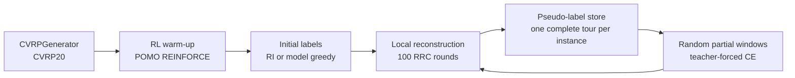

# Self-improvement by local reconstruction (SIL-RC)

How POMO is trained by the second SIL method: an RL warm-up, then teacher-forced
cross-entropy on sub-paths of labels that the policy improves itself with LEHD's
random reconstruction. Written for anyone running or changing
`notebooks/POMO_sil_rc.py`, `notebooks/POMO_sil_rc_step.py`, `src/sil_rc/`,
`src/envs/cvrp_sil_rc.py` and `src/models/pomo_sil_rc.py`.

The reference is the CVRP training code at `/home/toothlessos/Projects/nrp/SIL/`
(the SIT implementation of *Boosting Neural Combinatorial Optimization for
Large-Scale Vehicle Routing Problems*, ICLR 2025; arXiv 2403.19561 is the earlier
SIL paper). The existing [SIL.md](SIL.md) documents the other SIL arm, which
generates pseudo-experts with WOR-SBS search; this one improves them with a local
reconstruction.

This document covers the **POMO backbone**. The same pipeline with the reference
LEHD light encoder / heavy decoder, including its exact 2N teacher-forced loss
and the reference-checkpoint parity tests, is in
[LEHD_SIL_RC.md](LEHD_SIL_RC.md).

## Why this exists

The repo now trains CVRP100 five ways: POMO REINFORCE on generated instances
(`rl-`), teacher forcing on HGS tours (`sl-`), LEHD partial reconstruction
(`lehd-`), SBS self-improvement (`sil-`), and this local-reconstruction
self-improvement (`sil_rc-`). No reference solution is read by the last two.

The paper's claim is that local reconstruction is a better pseudo-label generator
than SBS: the improvement happens inside the model's decoder, on the GPU, instead
of in a CPU beam search. The pipeline is:



The reconstruction is model-based: the policy cuts a contiguous window ending at a
route end, re-decodes it greedily from its forced first customer, splices it back,
and keeps it only if the exact tour gets shorter. The training example is a random
sub-path of the improved tour, exactly the LEHD objective.

## What the reference does

### Warm-up

The reference repo contains no warm-up code; the paper specifies one. Both entry
points implement it with this repo's `POMORL`.

| item | value |
| --- | --- |
| problem | CVRP20, uniform coordinates, demands 1..9, capacity 30 |
| algorithm | POMO REINFORCE, shared baseline over `n = N = 20` starts |
| epochs | 100 |
| instances / epoch | 50,000 |
| batch size | 64 |
| optimizer | Adam, lr 1e-4 |
| wall clock | 15.42 h on one RTX 3090 |
| purpose | give the policy a useful prior for model-based reconstruction |

The step-matched entry point keeps the same distribution but fits the 2,000
rollouts per optimizer step geometry: 50 epochs x 100 steps x 125 instances x 16
starts (625k instances, 5,000 steps).

### SIL stage

The reference's outer loop (`Trainer.run`) has two levels:

1. **Repair pass over the whole fixed instance set.** `repair_all_data` loops over
   every instance in chunks of `repair_batch` and runs `budget` reconstruction
   rounds on each. `repair_batch` is the GPU chunk size, not the number of labels.
2. **Training block.** Only after every chunk is repaired does the model train
   `epoch_itervel` epochs over the whole label set, by teacher forcing on random
   sub-paths. The model then keeps its best validation checkpoint and starts the
   next repair pass.

The reference's three label paths, selected by `RI_initial` and
`first_time_repair`, are:

| path | initial labels | first repair | use |
| --- | --- | --- | --- |
| `RI_initial=True, first_time_repair=True` | random insertion | none (`budget=0`) | train from scratch |
| `RI_initial=False, first_time_repair=True` | the model's greedy rollout | 100 rounds | start from a warm-up model |
| `RI_initial=False, first_time_repair=False` | loaded from disk | 100 rounds | resume/refine |

This port's `--init greedy` and `--init random_insertion` select the first two
paths; the label sidecar plays the role of the disk labels for the third.

### Reconstruction round

Per iteration (`VRPEnv.sampling_subpaths_repair_V2`, `VRPEnv.decide_whether_to_
repair_solution_V2`):

- randomly flip the whole solution and each route (label-preserving), and rotate
  the route list;
- choose a route end, cut a window of `L ~ Unif{4 .. min(N, max_subtour_length)}`
  customers ending there, and renumber it `1..L`;
- greedily re-decode the window from its first customer with the model;
- splice the new window back and keep it iff the **segment** is shorter;
- reconstruct `factor = min(floor(N/L), min route count, 2 if N<200)` non-overlapping
  windows per iteration in parallel. At N=100 that averages ~1.5 windows.

The port uses `run_rrc_from_routes`, which does one window per iteration and
accepts on the **exact full-tour** cost. The full-tour test is stronger than the
reference's segment test and keeps label costs monotone; the two agree whenever
the splice context is unchanged. Raising the budget to ~150 matches the
reference's segment count at N=100.

### Training example and loss

One batch draws one `fix_length ~ Unif{4 .. min(N,1000)}` for the whole batch,
samples a contiguous window ending at a route end from each label, and
teacher-forces the policy through it. The loss is cross-entropy on the target
action; the forced first customer is not scored. The reference steps the optimizer
once per decoded token and clips at 10; this port takes one step per effective
batch with the LEHD per-row mean CE (the same deviation `LEHDPOMOSL` documents),
which is what makes the step-matched comparison possible.

Both the reference and this port generate labels with the **best-validation
weights**. The reference reloads only `model_state_dict` at the start of each
repair pass and deliberately leaves those weights in the model for the following
training block; Adam's moments and the LR schedule continue. The port reproduces
this in `_initial_labels`/`_repair_labels` (the first greedy bootstrap included).

### Parameter table

The code and paper disagree on some cells; both are shown. The CVRP100 row exists
only as a comment in `train.py`, not in the paper's table.

| parameter | reference CVRP1000 default | reference CVRP100 comment | paper Table 8 (CVRP1K) | port, strict | port, step-matched |
| --- | --- | --- | --- | --- | --- |
| instances | 20,000 | 1,000,000 | 10,000 | 1,000,000 generated | 12,500 / cycle, 5 cycles |
| train batch | 256 | 1,024 | 512 | 1,024 effective | 2,000 effective (500 x 4) |
| repair batch | 256 | 1,024 | 1,024 | 1,024 | 500 |
| improve cycles | 8 | 5 | 11 | 5 | 5 |
| epochs / cycle | 20 | 20 | 20 | 20 | 30 |
| total SIL epochs | 160 | 100 | 220 | 100 | 150 |
| reconstruction iterations / cycle | 100 | 100 | 100 | 100 | 100 |
| window length | U{4..min(N,1000)} | same | same | U{4..100} | U{4..100} |
| parallel windows | 1..2 (N<200 cap) | 1..2 | `floor(l_max/w)` | 1 (RRC) | 1 (RRC) |
| initial label | random insertion | random insertion | RI or greedy | greedy + refine (warm-up path); RI (from scratch) | same |
| optimizer | Adam 1e-4 | Adam 1e-4 | Adam 1e-4 | Adam 1e-4, wd 0 | Adam 1e-4, wd 1e-6 |
| LR schedule | 0.97 / epoch | 0.97 / epoch | 0.97 / epoch | 0.97 / epoch | constant |
| gradient clip | 10.0 | 10.0 | — | 10.0 | 1.0 |
| label-improvement model | best validation | best validation | — | best `val/reward_greedy` | same |
| total epochs incl. warm-up | — | — | — | 100 + 100 = 200 | 50 + 150 = 200 |

## The two entry points

### Strict port (`notebooks/POMO_sil_rc.py`)

- Warm-up: 100 epochs x 50,000 CVRP20 instances, batch 64, Adam 1e-4, no LR decay.
- SIL: 5 cycles x 20 epochs over a fixed 1,000,000 generated CVRP100 set.
  - initial labels: greedy + first repair (default with a warm-up), or random
    insertion + no first repair (`--from-scratch`);
  - 100 RRC rounds per instance per cycle with the best validation policy;
  - one random sub-path per instance per epoch, batch 1,024, Adam 1e-4, no weight
    decay, gradient clip 10, `MultiStepLR(gamma=0.97)` per SIL epoch;
  - validation on the HGS100 tail, 10,000 slots, 8 augmentations, N=100 starts.
- `--warmup-checkpoint` starts directly in SIL from a POMO state dict and sets the
  SIL budget to the reference's 100 epochs.
- The 1M-instance default is expensive; `--labels` and `--smoke` are the first
  knobs to lower.

### Step-matched port (`notebooks/POMO_sil_rc_step.py`)

- 200 epochs x 100 steps = 20,000 optimizer steps, per
  [ComparisonProtocol.md](ComparisonProtocol.md).
- Warm-up: 50 epochs x 100 steps, 125 CVRP20 instances x 16 starts = 2,000
  rollouts/step (5,000 steps).
- SIL: 150 epochs, five 30-epoch cycles. Each cycle generates 12,500 fresh CVRP100
  instances, bootstraps greedy labels, runs 100 RRC rounds, then trains on
  12,500 instances x 16 partial windows = 200,000 rows/epoch, micro 500 x accum 4
  = 2,000 partials/step (15,000 steps).
- The warm-up and SIL phases use different accumulation factors; a callback sets
  `trainer.accumulate_grad_batches` at each epoch start because Lightning 2.6 does
  not accept an epoch-keyed dict.
- Validation is the other arms' 2,000-slot, 8-augmentation, N=100-start draw.

## Files and reuse

| path | role |
| --- | --- |
| `src/sil_rc/insertion.py` | NumPy port of GLOP's capacity-feasible cheapest insertion |
| `src/sil_rc/labels.py` | seeded instance generation, `LabelStore`, initial labels, persistence |
| `src/sil_rc/reconstruction.py` | one full repair pass over the store |
| `src/sil_rc/dataset.py` | in-memory partial windows, one `w` per effective batch |
| `src/envs/cvrp_sil_rc.py` | CVRP20 warm-up + full-size label generation + file-backed validation |
| `src/models/pomo_sil_rc.py` | phase switch, label cycles, best-policy snapshot, LR schedule |
| `notebooks/POMO_sil_rc.py` | strict schedule |
| `notebooks/POMO_sil_rc_step.py` | step-matched schedule |
| `scripts/verify_sil_rc.py` | executable invariants |
| `scripts/submit_sil_rc.sh` | both arms, one GPU each |

Reused unchanged:

- `src/lehd/subpath.py` for window geometry, flips, teacher actions, capacity
  prefix and `cost_from_flags`;
- `src/rrc/runner.py`'s reconstruction loop, via the new
  `run_rrc_from_routes` entry point (`run_rrc` itself is unchanged);
- `PartialResetMixin.reset_partial` for the post-start state;
- `collate_partials` and the `LEHDPOMOSL` per-row CE, via the extracted
  `partial_teacher_forced_train_step` helper;
- `POMOSIL`'s two-phase/best-snapshot/checkpoint pattern.

## Seeding and reproducibility

Every data draw is keyed explicitly; no draw consumes the global RNG or depends on
DataLoader worker count.

- Both entry points call `seed_everything(SEED, workers=True)` before constructing
  the env/model, and pass `seed=SEED` to the env (rl4co otherwise draws its own
  env seed and unseeds model init).
- Warm-up batches are generated in `torch.random.fork_rng(devices=[])` with
  `manual_seed(SEED + current_epoch)`; the step arm's start nodes use
  `default_rng([SEED + epoch, k])`. The seed comes from `current_epoch`, not
  `env._epoch`, so a resume does not depend on how many throwaway datasets
  `setup()` built.
- SIL instances use a fixed `LABEL_SEED`, generated in blocks of
  `LABEL_GEN_BLOCK = 10_000` under `manual_seed([LABEL_SEED, block])`. The block
  size is part of the recipe because the generator consumes its RNG by batch
  shape. The strict arm draws once; the step arm draws `LABEL_SEED + cycle` per
  cycle; the smoke path uses the same code with smaller counts.
- Random insertion is deterministic (polar-angle order, cheapest feasible
  position); `order="random"` seeds `[LABEL_SEED, instance]`. Greedy labels are
  argmax decodes, deterministic given the policy snapshot.
- Repair uses `RRCConfig.seed = LABEL_SEED + cycle`; `w` is drawn per iteration
  from `[seed, iteration]` and each window from
  `[seed, iteration, global_label_index]`. The global index (not the chunk row) is
  what makes `repair_batch` a pure memory knob.
- Training windows use `[seed + epoch, label_index, window_index]` per item and
  `[seed + epoch, effective_batch_chunk]` for `w`; the loader does not shuffle.
  The effective batch size is part of the recipe.
- The label sidecar (`sil_rc_labels.npz`) stores the arrays and metadata (count,
  `num_loc`, capacity, label seed, block size, init, cycle, recon iterations,
  `backbone`, policy signature). It is written atomically after each full repair
  pass and validated on load, so a resume neither redraws nor loses the store. A
  mismatched sidecar is ignored and regenerated; a sidecar from another backbone
  is refused rather than reused (legacy sidecars without the field count as
  POMO). Checkpoints record the same backbone and refuse a cross-backbone resume.
- The repair policy is the `val/reward_greedy` best snapshot, saved in the
  checkpoint; after a resume the same weights repair the same labels.
- Data and schedule are reproducible exactly. Training is not promised bitwise on
  GPU (bf16/cuDNN); decoder batching changes fp accumulation by ~1e-6, so
  `repair_batch` and the label-generation block size are recorded as part of the
  recipe.

## Deliberate deviations

1. **Backbone.** The reference's linear cross-attention network is replaced by the
   repo's POMO `AttentionModelPolicy` (same 128/8-head/512/6-layer shape, full
   attention). This is the POMO variant; the reference LEHD network is available
   as a drop-in alternative, documented in [LEHD_SIL_RC.md](LEHD_SIL_RC.md).
2. **Action space.** POMO's `0 = depot, 1..N = customers` replaces the reference's
   `2N` `(customer, via_depot)` space; a route boundary is an extra depot token.
3. **Optimizer steps.** One step per effective batch with the per-row CE, not one
   per decoded token (the same deviation as the LEHD-SL arm).
4. **Parallel windows.** One window per iteration, not up to two. The budget stays
   100; raise it to ~150 for segment-count parity.
5. **Acceptance.** Exact full-tour cost, not the segment's own cost; stronger and
   monotone.
6. **Angular route sort.** The reference canonicalises route order by centroid
   angle before each round; the port's `sample_window` flips/rotates instead. The
   distribution over route ends is unchanged.
7. **Warm-up location.** The reference repo has no warm-up code; the CVRP20 stage
   is implemented with this repo's `POMORL`.
8. **Fixed vs fresh instances.** Strict keeps one fixed 1M set; the step arm draws
   12,500 fresh instances per cycle (62,500 unique over five cycles) rather than
   reusing 12,500 labels for 150 epochs.
9. **Warm-up data size in the step arm.** 625k instances rather than the paper's
   5M, because the 2,000-rollouts/step geometry is the comparison unit.
10. **Precision.** bf16-mixed by default; `--smoke` uses fp32.
11. **Validation set.** The paper validates on CVRP1000; this port validates on the
    repo's held-out HGS100 tail so every arm is scored on the same instances.
12. **Step-arm cycle length.** 30 epochs rather than 20, so five cycles fill 150
    SIL epochs. The warm-up consumes 5,000 of the 20,000 optimizer steps.
13. **Step-arm training geometry.** 16 windows per instance per epoch, not one,
    to hit 2,000 partials per step.
14. **Optimizer across the phase switch.** A single Lightning fit carries the
    warm-up Adam moments into SIL; `--warmup-checkpoint` starts the SIL fit with a
    fresh optimizer.
15. **Reference bugs not ported.** `Trainer.run()` returns `None` while `main()`
    unpacks it; the non-PRC `destroy_solution` path references a missing
    `env_params['mode']`; `trainer_params['epochs']=3000` is only a time-estimator
    bound. This port uses `cycles x epochs_per_cycle`.
16. **Epoch numbering.** The reference re-bases each cycle's training at
    `best_epoch + 1`, so epoch indices can repeat while the scheduler keeps
    stepping. This port uses a monotonic global epoch; the number of training
    epochs, optimizer steps and the once-per-epoch LR decay are unchanged.

## Running it

```bash
# Pipeline checks (tiny, CPU-capable, no SwanLab)
.venv/bin/python notebooks/POMO_sil_rc.py --smoke
.venv/bin/python notebooks/POMO_sil_rc.py --smoke --from-scratch
.venv/bin/python notebooks/POMO_sil_rc_step.py --smoke

# Unit/invariant checks
.venv/bin/python scripts/verify_sil_rc.py

# Full arms, one GPU each
sbatch scripts/submit_sil_rc.sh

# Strict arm on a smaller first run
.venv/bin/python notebooks/POMO_sil_rc.py --labels 100000
```

Evaluate a checkpoint with the existing driver; the run prefix is `sil_rc`:

```bash
.venv/bin/python notebooks/eval_pomo.py
```

## Verification

`scripts/verify_sil_rc.py` checks:

1. insertion coverage, capacity, determinism and seeded random order;
2. seeded instance generation and integral demands;
3. random-insertion and greedy label feasibility, exact cost replay, sidecar
   round trip and metadata rejection;
4. every `SILPartialDataset` item against the `sample_window` oracle, seeded item
   reproducibility, collation and the one-`w`-per-micro-batch rule;
5. `run_rrc_from_routes` monotonicity, exact splice replay, feasibility, and the
   same result from two half-batches as from the whole batch;
6. one full repair pass's monotonicity, counters and feasibility;
7. the step constants producing exactly 100 steps per epoch in both phases and the
   50 + 150 = 200-epoch schedule;
8. a tiny two-phase fit that creates labels and a best snapshot, and a checkpoint
   resume that must load the sidecar rather than redraw it, plus the step env's
   start-node attachment.

`docs/` and the reference-vs-port table above are the record of where this port
deliberately differs from the official implementation.
